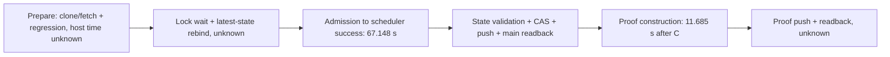

# Monitor latency: bounded readback and historical IO candidates

This is a source/CI candidate, not a deployed speedup or a three-second SLA.
Baseline main is `9e97739a3e52db0979d3100284e960f47db68984` (2026-10-11).
Its tree includes merged PR104, PR105, PR107 and PR106. No `AGENTS.md` exists in
that repository tree or this task's ancestor directories. PR101 is independent;
its public-market transport/cache code is untouched. No server connection,
configuration, permission, timer, installed wrapper, strategy dispatch or real
trade was used for this work. The existing installed-wrapper limitation remains.

## Measured critical path and the three-second question

Read-only receipts at the baseline commit:

* `research/results/hunter-scheduler-health.json`: monitor started
  `22:21:48.337795Z`, completed `22:22:55.485309Z`, **67.148 s**.
* `research/results/hunter-position-monitor.json` / `timing_seconds`: monitor
  body **53.882985 s**, market **2.775920 s**, management evidence **11.632323 s**
  (including 1h **1.964339**, 4h **1.979142**, micro **1.947465**), Bybit evidence
  **0.000023 s**, systemic evidence **3.777064 s**, leading evidence **0.483017 s**,
  V1 lifecycle **17.345510 s**, V2 lifecycle **15.046305 s**.
* `research/results/hunter-runtime-monitor-health.json`: proof document created
  `22:23:07.170027Z`, **11.684718 s after scheduler completion**. This proves
  the first state publication/readback was done before proof construction. It
  does not time the proof's own subsequent push/readback, nor pure disk durability.



Within C, the 53.883-second body contains acquisitions, both lifecycle runs and
local writes. Lifecycle includes historical backfill, summaries and JSON writes;
it is **not** pure CPU decision time. Nested evidence durations overlap their
parent and must not be added twice. The remaining 2.823 s within body is unlabelled
work (including exit books/read/write overhead), not an independently measured
network span. The difference between scheduler/body clocks is likewise unclassified.

| Requested segment | Current evidence | Three-second status |
| --- | --- | --- |
| Quote to decision | Mixed body 53.883 s; lifecycle 17.346 + 15.046 s includes backfill/write | Pure decision boundary not measured; current acquired-data path cannot be claimed below 3 s |
| Decision to reliable persistence | 11.685 s completion-to-proof-construction gap; separate offline state publication A/B below | No host durability/decision boundary measurement; no 3 s claim |
| Entire cycle including Git main readback | At least the 78.832513 s admission-to-proof-construction window, plus preparation, waiting and final proof publication | Clearly not established at 3 s |

These are **one** production receipt, not p95/p99 samples. No production benchmark
or live market call was initiated. For comparison only, the already authorized
[prior Linux capacity run](https://github.com/leo14881-eng/btc-grid-state/actions/runs/38179907084)
at code `373e635` reports four 1x local simulated publications of
1.250462 / 5.845991 / 1.238282 / 1.339542 seconds. The seven `git show` calls
account for about 0.080 s; those local file-transport, earlier-payload observations
are not production or current-candidate A/B results.

The source still has sequential network stages and bounded backfill. Individual
market calls allow 25 s; signal requests 8 s with 64 workers; depth requests 6 s
with management/exit pools of 16/8; systemic/leading calls allow 8 s and fallback
chains; historical requests allow 4 s, with per-lane budgets. Socket timeouts are
not total wall-clock deadlines for DNS, payload streaming or the whole pipeline.
Git subprocesses have no independent timeout. `TimeoutStartSec=240` is a service
failure deadline in source, not a successful-run bound or evidence of installed
configuration. Thus there is **no proven successful network upper bound** below
three seconds. Tightening these limits would change data availability and is not
part of this candidate.

## Change and invariants

Seven independent `git show` processes are replaced by one `rev-parse` that pins
the requested fetched ref and one `git cat-file --batch` process. There is no
cross-call cache. Every read resolves again; all seven documents belong to one
immutable commit, even if a mutable ref changes during the read.

Git's documented byte-count framing is checked before decoding: ordered path
labels, valid object ID, blob type, nonnegative size, delimiter, all seven objects,
no trailing output, strict decoding. Missing objects (which Git can report with
exit status zero), truncation, unexpected type/order, invalid encoding and command
failure all abort. Text encoding/newline normalization match the legacy reader.
An entire snapshot is still transferred and decoded; this does not reduce its
21,444,185-byte payload, JSON cost or Git network traffic. Peak batch buffering
also increases transient memory versus reading one blob at a time; growing-ledger
host memory acceptance remains necessary.

`validate`, `tested_input`, `protected`, rebind, generation guard, CAS, push retry,
ancestor checks, byte-for-byte text snapshot equality and primary-proof publication
are unchanged. Local worktree reads remain uncached. The capacity harness only
gains binary stdin forwarding so its protocol restrictions and Git instrumentation
also cover `cat-file`.

## Reproduction and measured A/B

Before editing, 20 reads of the pinned source with seven `git show` calls gave a
Windows median **0.892162 s**. One validation took **0.217005 s**. The original
six-module preparation suite passed **141 tests in 111.262 s** on Windows/Python
3.10. These establish repeated work; they are not a paired speedup comparison or
server estimates.

Run from an isolated source checkout:

```sh
python -m unittest tests.test_hunter_monitor_snapshot -v
python scripts/hunter_monitor_snapshot_benchmark.py --source-ref HEAD \
  --iterations 100 --cycles 12 --output /tmp/hunter-snapshot-ab.json
```

The harness reads source Git without fetching, copies the seven source documents
into newly created temporary repositories, disables hooks/user Git config and
allows **only local file transport**. No strategy runs. Publication changes only
synthetic generation/revision metadata. Both arms begin with identical data and
independent Git histories; A/B order alternates. The baseline snapshot function is
the frozen three-line reader from `9e97739`. All outputs are compared, source
working-file hashes must remain unchanged, historical/capital payload hashes must
match and exactly one commit per simulated publication is required. Primary proof
publication is excluded, explicitly recorded as such in the machine report.

Windows paired results (30 reads per arm, four publications per arm):

| Stage | Legacy median | Candidate median | Interpretation |
| --- | ---: | ---: | --- |
| Seven-document snapshot read | 0.444449 s | 0.220103 s | 50.5% lower; five fewer process launches |
| State publication including CAS/push/main readback | 5.049285 s | 5.488926 s | 8.7% higher in four noisy samples; no full-publication speedup established |

The separate initial 0.892-second measurement used the source repository's object
layout/sandbox; the paired A/B uses copied local objects and a common environment.
Do not compare that initial value directly with the candidate's A/B value.
Local regression work ran concurrently with this small Windows A/B; CI provides
an additional Linux comparison. Machine samples, hashes and platform details are
in `docs/replays/hunter-monitor-snapshot-ab-windows.json`. Empirical p95/p99 are
reported as sample descriptions only. Thirty or 100 reads and four or 12 full
publications are insufficient to validate a production p95/p99 target.

The PR's `Hunter Vultr Runner Infrastructure` workflow retains the complete Hunter
regression and 1x/2x/5x contention-capacity jobs, and adds batch fault tests plus
100-read/12-publication Linux A/B with artifact `hunter-snapshot-ab`. Timing has no
pass/fail threshold; content, CAS, history and failure handling must pass. Exact
head and CI links belong in the PR evidence; do not substitute an earlier run.

## Larger candidates and acceptance gates

Preparation caching has a potentially much larger payoff than 80 ms of Linux
object-read overhead. It is deliberately **not implemented as an unsafe timestamp
or commit-only success stamp**: tests import `hunter-shadow-rules.json`, read
source and guard data, use environment-dependent paths and invoke Git. Cacheable
tests first need an audited immutable input closure and isolated fixture runtime.
The key must include every code/test/helper/fixture/config input, dependency and
interpreter/Git identity, command, relevant sanitized environment and cache format.
Unexpected mutable-file access must make an action uncacheable. Tests stay intact;
all current-state guards still execute after locked latest-main rebind. Acceptance
must cover changed/added/deleted input, dependency and environment drift, mutations
during tests, poisoned/truncated cache, disk full, permissions, crash, restart,
concurrent writers and negative test outcomes. No cache or shared preparation
directory is reused by this PR.

A resident hot decision path could target three seconds **only after** measuring
fresh evidence availability and isolating decision CPU from backfill/report work.
It needs one authoritative generation owner, immutable event identities, a durable
transactional outbox, no success acknowledgement before durable write, duplicate
replay/CAS fencing, crash/restore tests and comparison of complete decisions against
the current engine. Moving Git off that acknowledged path changes the current
main-readback meaning of success and requires a separate authority/rollback design.
Database authority or hot/cold history needs lossless reconstruction, atomic
two-ledger commit, replay equivalence, recovery and backup verification. None of
those migrations, flags or deployment changes is included here.

Use at least thousands of independent cold/warm/failure/restart observations on
the intended host, with quote timestamp, decision timestamp, local durable receipt,
state Git readback and final proof readback recorded separately. Set sample size
and confidence criteria before claiming p95/p99; 100 samples provide only about
one observation in the upper one percent, with no robust tail confidence.

## Official implementation references

* [Git cat-file batch output](https://git-scm.com/docs/git-cat-file): byte sizes,
  object types, custom `rest` labels and special missing-object responses.
* [Git rev-parse](https://git-scm.com/docs/git-rev-parse): verify and peel one
  immutable commit before reading its paths.
* [Bazel action caching](https://bazel.build/remote/caching) and
  [hermeticity](https://bazel.build/basics/hermeticity): declared inputs,
  commands/environment and toolchain isolation before reusing test results.
* [Python monotonic performance counter](https://docs.python.org/3/library/time.html#time.perf_counter):
  elapsed wall-clock intervals for paired measurements.

Only anonymous technical documentation queries were sent to public search. No
private source, ledger or credential was sent to Claude or another external model.

## Seconds-level follow-up: synchronous historical pages

The follow-up fixes input state at `390fca24a4bcd3537739f0a4caa48dba8e070aab`
(the source/input revision for the 22:20 generation). It starts from newer main
`69c369b75c1ec9c8a1d62fe8f7f510e8428986d6`, retaining the first candidate.
No results/ledger file is edited by the candidate. `HUNTER_MONITOR_HISTORY_WORKERS`
defaults to **1**; only explicit 2 or 4 selects parallel historical observation.
No installed service environment or wrapper has been changed.

The actual production receipts below use the same field names throughout; raw
source revisions, receipt commits and counts are in
`replays/hunter-monitor-production-timings.json`. They are eight observations,
not a controlled production A/B.

| Generation UTC | Scheduler span s | Monitor body s | Management evidence s | V1 lifecycle s | V2 lifecycle s | Open V1/V2 | Wanted assets |
| --- | ---: | ---: | ---: | ---: | ---: | --- | ---: |
| 22:05 | 51.553 | 39.738 | 11.626 | 16.821 | 1.330 | 172/8 | 253 |
| 22:10 | 50.776 | 38.967 | 11.649 | 15.341 | 2.018 | 172/8 | 253 |
| 22:20 | 67.148 | 53.883 | 11.632 | 17.346 | 15.046 | 172/8 | 288 |
| 22:25 | 66.711 | 55.194 | 11.769 | 17.821 | 15.721 | 172/8 | 286 |
| 22:30 | 63.282 | 50.117 | 11.646 | 17.066 | 11.234 | 173/10 | 285 |
| 22:35 | 60.486 | 48.381 | 11.485 | 16.815 | 10.211 | 173/10 | 279 |
| 22:40 | 51.650 | 40.091 | 11.622 | 17.494 | 0.409 | 173/10 | 273 |
| 22:45 | 50.822 | 39.181 | 11.600 | 16.977 | 0.397 | 173/10 | 272 |

Every row attempted 80 management holdings and obtained 80 management books.
Exit books were 15,14,14,14,16,16,16,16; reported failures were empty. Production
receipts do **not** record actual historical HTTP counts or preparation/lock
timings. The 22:10 to 22:20 body increase was 14.916s; V2 lifecycle alone increased
13.028s. This identifies a mixed lifecycle stage, not a CPU regression. The later
39.181s body is not a PR109 speedup: that candidate was not deployed. The parent
also independently verified that all 20 then-due closed 72h observations reached
continuous 863/863 coverage; seven younger records were not yet due. Completion
of that backlog is consistent with the V2 stage falling to 0.397s, but these
receipts alone cannot allocate every millisecond or establish causal speedup.

### Same input, before and after PR107

`scripts/hunter_monitor_phase_replay.py` exports versioned code into a disposable
repository, overlays the exact same results tree, freezes the observation clock,
and uses deterministic synthetic HTTP responses. Unknown endpoints, DNS and live
sockets abort. Its only Git origin is a temporary local bare repository; it runs
the real monitor, current-state validator, publisher and final primary-proof
publication/readback. The observer-only host reconciliation is explicitly stubbed.
It never dispatches a strategy workflow or accesses an exchange.

With no injected HTTP delay, pre107 code `dcf39c9f5f95222d711981986b6fbabe0cb3e006`
issued **8 historical requests, all V1**; post107 source `390fca2` issued **16,
8 per lane**. Both issued 352 quote/evidence requests in this synthetic fixture.
Decision/event hashes matched exactly:
`ac3f1954f494f79aa5a4be5d345a9ebf1b35bb9869b85c53a7ce0a8cbe00bdc1`.
Full observation outputs correctly differ: PR107 restores V2's independent budget
and coverage reconstruction. Monitor bodies were 1.994s and 2.056s respectively;
management decision functions totalled 15.819ms and 15.507ms. These one-shot
Windows measurements and invented provider payloads do not establish live quote
freshness, server CPU tails, or a three-second full-cycle SLA.

This evidence prioritizes historical IO inside the 53s body over test caching:
the six-module preparation tests execute outside this body's timer. The separate
111.262s Windows preparation measurement still matters to end-to-end cold start;
it is not evidence that the server spends that long in tests. The hermetic cache
input-closure and poisoning requirements above remain unimplemented. No tests,
mutable-state guards or preparation checks were skipped to obtain these results.

### Bounded synchronous implementation and failure contract

After ordinary closed-position marking, the candidate uses the unchanged selector
and coverage logic on a disposable observation copy to plan the exact page list
and cursor. It fetches only those pages with at most four threads, joins every
response, then invokes ordinary coverage processing in original selection order.
The page budget remains eight per lane, including failed requests. Open-position
backfill consumes any remaining budget through its original serial path.
Threads touch neither portfolio objects nor the shared page counter. No response
survives a refresh, crosses a generation, or feeds real-time quote decisions.

Each closed position is visited once; its response cannot influence a later
distinct position's selection. Aliased positions are rejected. Any counter drift,
request/key mismatch, excess page or unconsumed plan aborts before the caller's
portfolio write/publication. HTTP timeout or malformed JSON retains the original
pending coverage semantics and consumes its original budget unit. Gap, conflicting
duplicate, incomplete horizon and restart logic all still comes from PR107.
The pure transport split retains the original endpoint, parameters, headers,
four-second per-operation timeout and at-most-1000 returned candles. CAS,
generation checks, authoritative main readback and proof publication are untouched.

This is synchronous overlap of already selected historical IO. Moving backfill
to another persistent job would need separate generation ownership, checkpoint
CAS, atomic observation merge and crash/replay acceptance; that migration is not
part of this candidate. Bounded concurrency does raise instantaneous request
pressure, despite an identical request count. Real provider throttling and host
resource effects remain an enablement acceptance requirement.

The implementation follows the standard bounded
[Python executor and join model](https://docs.python.org/3/library/concurrent.futures.html)
and retains the documented
[Binance kline request contract](https://developers.binance.com/docs/binance-spot-api-docs/rest-api/market-data-endpoints).

### Reproduction and limits

```
python -m unittest tests.test_hunter_history_parallel tests.test_hunter_observation_history tests.test_hunter_monitor_boundaries tests.test_hunter_position_monitor -v
python scripts/hunter_monitor_history_benchmark.py --code-ref HEAD --iterations 3 --history-delay 1 --output /tmp/hunter-history-ab.json
```

The benchmark alternates 1/4 then 4/1 worker order. Each pair requires identical
input-manifest hashes, all seven normalized output documents (excluding timing),
decision/event hashes, HTTP request parameters, response sizes/hashes, per-lane
counts, verified state publication and verified final proof. Raw per-request files
are emitted next to its aggregate report. Three pairs are deliberately labelled
insufficient for p95/p99; the CI uses a shorter 0.2s injected request delay and
uploads its own raw reports. No synthetic delay is represented as measured internet
latency. Preparation, scheduler launch and lock wait are excluded from this replay.

Remaining limits are material: batch quotes allow 25s operation timeout, history
uses 4s operation timeout, other evidence has its own timeouts, and Git transport
has no demonstrated successful wall-clock ceiling. Socket read timeouts do not
create a hard overall DNS/TLS/streaming deadline. Parallel history cannot guarantee
a full cycle below 3s. Fast CPU decisions after fresh evidence are plausible from
this replay; actual quote-to-decision and crash-durable acknowledgement require
timestamped host measurements. Local atomic replace is not an fsync durability
measurement, and local file-only Git is not GitHub network latency.

Windows/Python 3.10.11 paired results, three samples per arm, 1s injected per historical request:

| Stage | Serial median s | Four-worker median s |
| --- | ---: | ---: |
| monitor_body | 18.552963 | 6.765417 |
| closed_history | 16.257725 | 4.355458 |
| decision_functions | 0.020724 | 0.019259 |
| json_writes | 1.173147 | 1.097641 |
| validation | 0.166727 | 0.202807 |
| publication_and_proof | 6.648289 | 7.541373 |
| proof | 2.430560 | 2.922543 |
| body_validation_publication | 25.233980 | 14.299479 |

Raw summary: `replays/hunter-monitor-history-ab-windows.json`. The complete body+validation+publication median falls 43.33% (10.935s) in this injected-wait fixture; the publication component itself is slower, so no publication improvement is claimed. All 16 historical requests and all seven output documents match. Local targeted regression: 45 tests passed.
